# Java Beats Rust on Every Front

A Word-compatible word processor written in **Java** with [Codename One](https://www.codenameone.com),
compiled ahead of time by ParparVM to native code (no JVM at run time). One codebase ships a
native macOS app, an iPhone/iPad app, an Android app and a browser app. It is measured head
to head against [Wordcraft](https://github.com/storytold/wordcraft) (pinned at `159b84f`), a
Rust/egui clone of the same 502-row Word feature catalog.

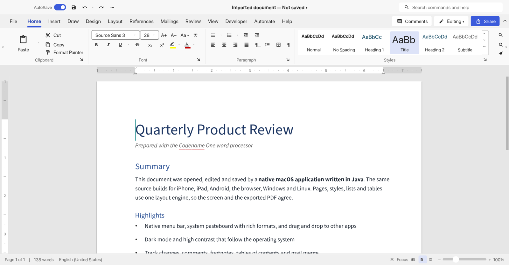

| Front | Java (this app) | Rust (Wordcraft) |
| --- | --- | --- |
| **Faster startup** | 79 / 144 / 217 ms | 279 / 290 / 481 ms |
| **Faster editing** | 3.4 ms insert, 5.6 ms save, 7.8 ms PDF | 12.0 ms insert, 9.6 ms save, 255 ms PDF |
| **Less RAM** | 137 / 163 / 197 MiB | 175 / 227 / 323 MiB |
| **Smaller on disk** | 33 MB app bundle | 57 MB app bundle |
| **More platforms from one source** | macOS, iPhone/iPad, Android, browser | desktop and browser |
| **More features, deeper native** | native menu bar, rich copy out, drag out, high contrast | see [below](#more-features-and-deeper-native) |
| **Equally functional** | 487 / 487 implementable catalog rows | 487 rows implemented, 15 stubs |
| **Easier for LLMs** | 42,475 lines, 490,197 tokens | 118,659 lines, 1,646,847 tokens |
| **Cheaper CI** | 623 functional tests in 6 s on the JVM | 1,921 tests after a 165 s compile |

Startup and RAM are for 1 / 1,000 / 10,000-paragraph documents (launch to first painted
document; idle resident memory). Code counts are application code without tests or comment
lines. Every number is reproduced by [CI](#proven-in-ci).

## Faster

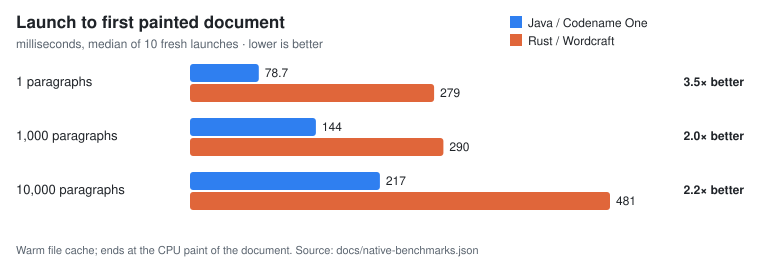

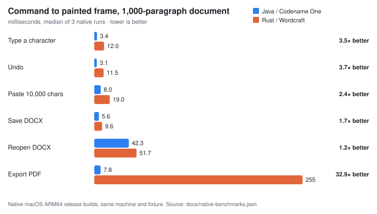

Latency is measured from the command to the first painted frame that shows its result,
with the 1,000-paragraph document. Java wins every operation: insert and undo about 3.5x,
paste 2.4x, save 1.7x, reopen 1.2x and PDF export about 33x. Our PDF exporter covers less
typography than Wordcraft's, so the PDF figure is not an equal-fidelity comparison
([FORMATS](docs/FORMATS.md)).

## Smaller

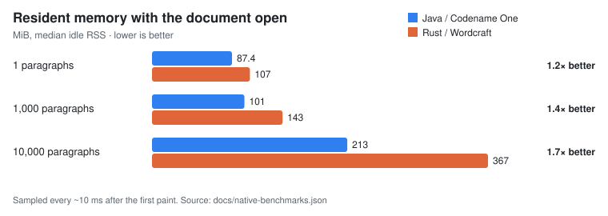

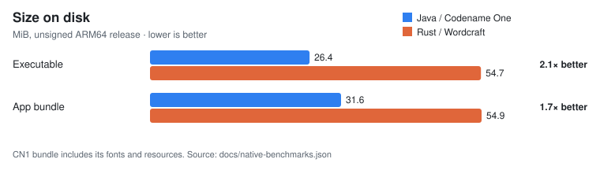

## One codebase, every platform

The same Java source, unchanged, builds and runs out of the box on each target:

| iPhone | Android | Browser |
| --- | --- | --- |
| 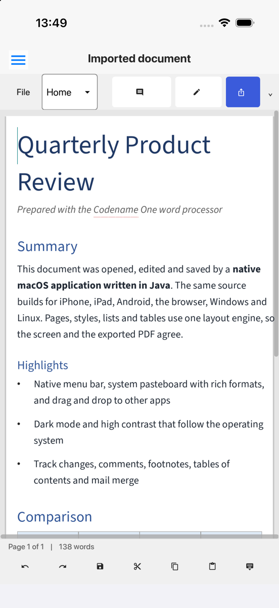 | 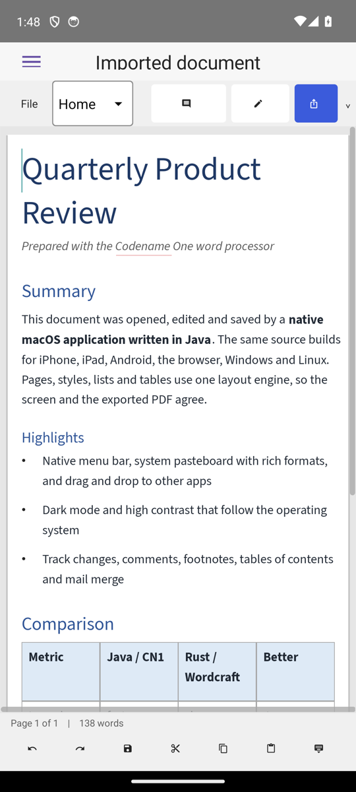 | 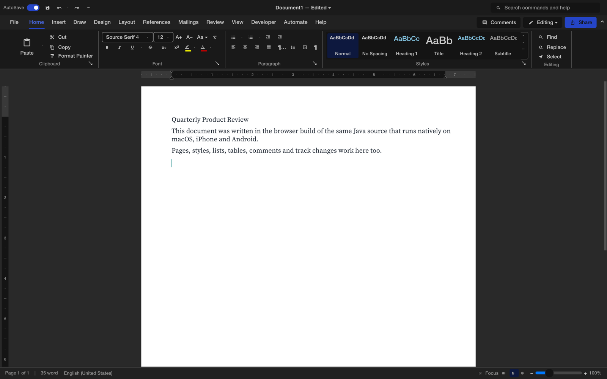 |

On phones the ribbon collapses to a tab picker, the page reflows to the screen width and a
touch toolbar replaces the status bar. Wordcraft has no mobile target.

## More Features and Deeper Native

Features this app provides that Wordcraft does not (Wordcraft references are to its source at
the pinned revision):

| Feature | This app | Wordcraft |
| --- | --- | --- |
| **macOS menu bar** | Native NSMenu with File, Edit, Insert, Format and Tools menus, about 40 commands with standard shortcuts | No menu bar; commands live only in the in-window ribbon |
| **Rich copy to other apps** | Copy and cut put HTML, RTF, Markdown, plain text and the native model on the system pasteboard, so Pages, Mail or a browser receive formatted text | Plain text only (`ctx.copy_text`) |
| **Drag out to other apps** | Drag a selection into another app as rich text; drags inside the document move text as one undo step | No drag source |
| **Drag in** | Files and text, dropped at the caret under the pointer | Files only |
| **Rich paste in** | HTML, RTF, Markdown, images and files | HTML, RTF and images |
| **High contrast** | Follows the OS accessibility setting live | Not supported |
| **iPhone and iPad** | Native iOS app with touch selection handles and keyboard-aware dialogs | No mobile target |
| **Android** | Native Android app from the same source | No mobile target |

Both apps follow the OS dark mode live:

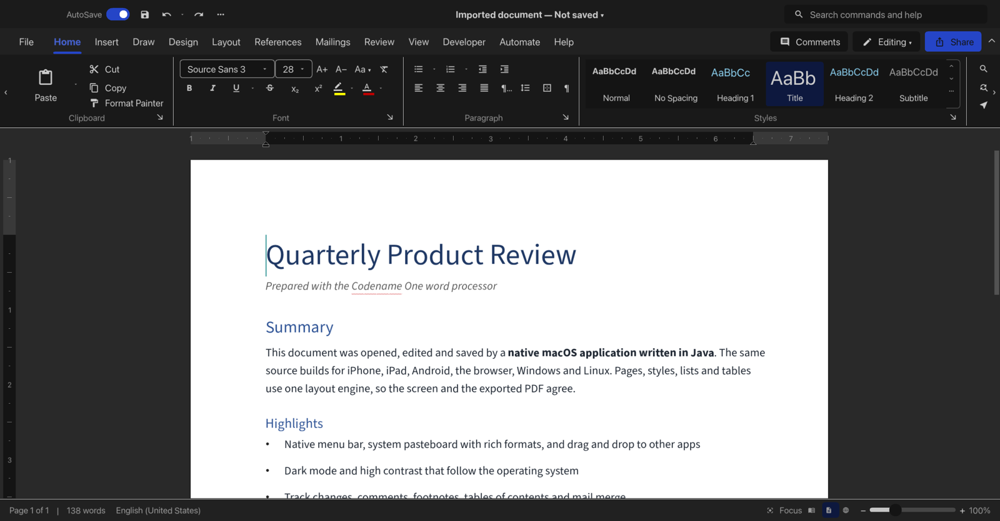

The complete comparison, including features where the two are level, is in
[NATIVE-FEATURES](docs/NATIVE-FEATURES.md).

## Easier for LLMs

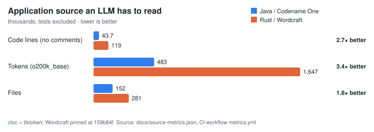

About a third of the code and a quarter of the tokens (tiktoken `o200k_base`) for the
same catalog: an agent reads the whole application in a fraction of the context, and every
edit touches less code.

## Cheaper CI

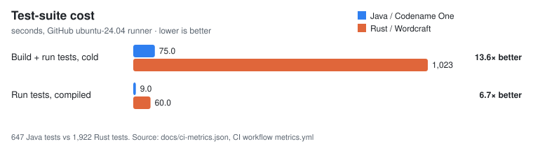

Functional tests run on the JVM against the same Java code that ships natively: the whole
suite of 623 tests compiles and runs in seconds, with no native toolchain. Rust must compile
its dependency tree and test binaries before running anything (165 s cold, 20 s for the test
run), so every pull request costs minutes of runner time: about 8 s from a cold checkout for
Java against about 185 s for Rust, roughly 23 times less CI time for the functional suite.

## Proven in CI

[`.github/workflows/metrics.yml`](.github/workflows/metrics.yml) reproduces every number above
for both projects on GitHub's runners:

| Job | Runner | What it proves |
| --- | --- | --- |
| `java` | Ubuntu | Cold build and functional-test time, test count, JVM engine benchmark, source lines and tokens |
| `wordcraft` | Ubuntu | Wordcraft's cold build and `cargo test` time and test count |
| `macos` | macOS | Startup, idle RAM, command-to-paint latency and bundle size of both native apps, same fixtures |
| `ios` | macOS | The same source built for the iPhone simulator, launch time, app size and a screenshot |
| `android` | Ubuntu | The same source built as an APK, cold-start time on an emulator, APK size and a screenshot |
| `web` | Ubuntu | The browser build, run headless in Chrome, bundle size and a screenshot |

The job summary prints each comparison table; raw runs and screenshots are uploaded as
workflow artifacts. Local runs use the same scripts (`scripts/native-bench/`).

## Build and run the native macOS application

Use JDK 17 for Maven (the sources use records, text blocks and switch expressions), Xcode,
and current Codename One `8.0-SNAPSHOT` artifacts. The
validated merged framework baseline is `008f9ece62526d807c2064887ad8f8641d6195a4` (PR #6019). The native
runtime must include the shared ZIP API. If using a local framework checkout, refresh its
ParparVM bundle when it is stale. Every framework and application Maven invocation must
use the same isolated repository via `-Dmaven.repo.local=...`; never install custom snapshots
in `~/.m2`. The scripts default to `.local/maven-repository` inside this project. To use a
unique external repository, set `WORDPROCESSOR_MAVEN_REPO` or save its absolute path in the
ignored `.local/maven-repo-path` file. Do not use a shared temporary repository name.

```sh
scripts/build-native.sh
scripts/run-desktop.sh
```

The script installs/tests the shared libraries, then uses the existing Codename One target:

```sh
source scripts/maven-env.sh
mvn -Dmaven.repo.local="$WORDPROCESSOR_MAVEN_REPO" -B \
  -Dcodename1.platform=ios -Dcodename1.buildTarget=mac-source package
```

This generates `common/target/app-common-0.1.0-SNAPSHOT-mac-source/Main.xcodeproj`.
The script builds its Release configuration with Xcode into
`common/target/mac-native/Build/Products/Release/Main.app` and the run script opens
that bundle. The binary uses AppKit and Metal and needs no JVM. Signing is disabled for
this local development build.

## Distributables and releases

[`.github/workflows/build.yml`](.github/workflows/build.yml) runs the tests, then builds every
platform from the same source and uploads each as a workflow artifact: macOS `.dmg`, iOS
simulator `.zip` and unsigned `.ipa`, Android `.apk`, web `.zip`, Linux x64/arm64 `.tar.gz` and
Windows x64/arm64 `.zip`. `scripts/dist.sh` packages them into `dist/`. Pushing a `v*` tag runs
[`release.yml`](.github/workflows/release.yml), which reuses that build and attaches every
package to a GitHub release. The Apple packages are unsigned; signing needs your certificates.

The standard CN1 lifecycle is `common/src/main/java/com/codenameone/wordprocessor/app/Main.java`.
It uses the shared `editor` application and CN1 platform file APIs.

## Libraries and tools

| Module | Responsibility |
| --- | --- |
| document | Styled text/block trees, selection, transactions, undo and composition |
| layout | Pagination, table layout and platform metrics interface |
| formats | Native project, DOCX, text adapters and PDF export |
| automation | Commands, macros, extensions and previews |
| editor | Codename One editor UI and recovery |
| common | Standard Codename One lifecycle and platform integration |
| cli | Separate JVM command-line and MCP development tools; no UI host |
| benchmarks | Model/import measurements and pinned Wordcraft inventory |

```sh
scripts/build.sh
scripts/wordprocessor help
scripts/wordprocessor new document.cn1doc
scripts/wordprocessor mcp --root "$PWD"
scripts/verify.sh
```

CLI files must be new paths. Known lossy DOCX conversion requires `--allow-conversion`.
The CLI is currently JVM tooling; its timings are not native application startup timings.
See [formats](docs/FORMATS.md), [automation](docs/AUTOMATION.md), and
[validation](docs/VALIDATION.md).


## Other targets

`common` is shared with Codename One's browser, Android and iOS targets.
`scripts/build-web.sh` builds the JavaScript target; `scripts/build-linux.sh` uses the local
native Linux target. See [Linux](docs/LINUX.md) and [platform evidence](docs/platforms.json).
Linux and Windows packages are built in CI only and have not been run on a desktop yet;
physical mobile devices remain unverified. Live native UI debugging uses the
optional [built-in MCP integration](docs/LIVE-MCP.md). A project license has not yet been
selected; see [third-party notices](third-party/README.md).

Regenerate the charts with `python3 scripts/readme-charts.py` after
`scripts/native-bench/report.py` and `scripts/source-metrics.py`.
